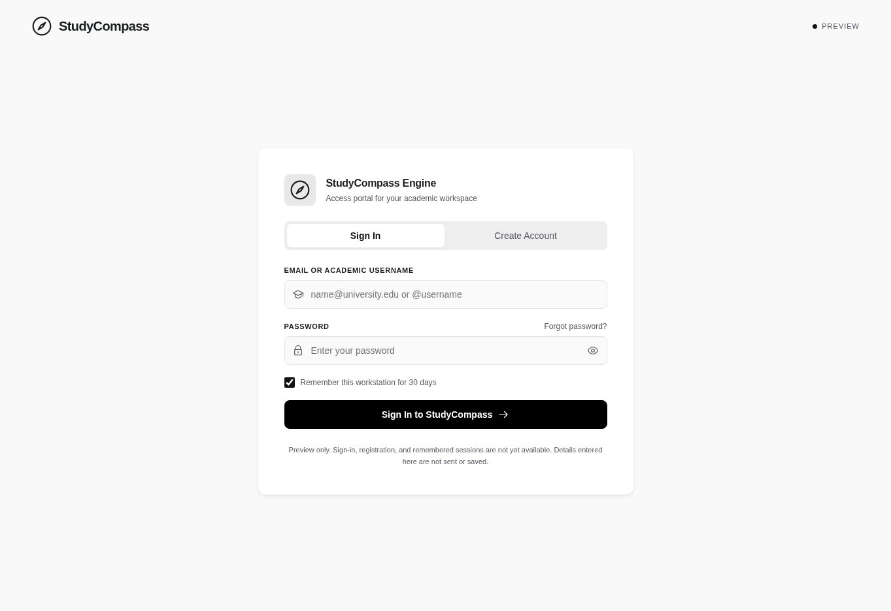

# User login page

This implements the Google Stitch login/create-account design for issue #48.
It follows the calendar dashboard's approach: React components, scoped plain
CSS, local SVG icons, and an explicit frontend preview. No dependency versions
or lockfile changed.



## Run it

From the repository root, using the team's existing Node version:

```sh
cd client
npm ci
npm run dev
```

Open the URL Vite prints. On this branch, `App.jsx` renders `UserLogin` as the
starting page. There is no router or server yet.

## How the code is organized

| File | Responsibility |
| --- | --- |
| `client/src/App.jsx` | Mounts the login page. |
| `client/src/pages/UserLogin.jsx` | Page layout, Sign In/Create Account tabs, and recovery dialog. |
| `client/src/pages/UserLogin.css` | Responsive styling under `sc-auth` to avoid collisions with other pages. |
| `client/src/components/auth/SignInForm.jsx` | Sign-in input, remember checkbox, validation, and preview feedback. |
| `client/src/components/auth/CreateAccountForm.jsx` | Registration input, password requirements, confirmation, and syllabus permission. |
| `client/src/components/auth/AuthField.jsx` | Reusable labeled input, password visibility toggle, hints, and field errors. |
| `client/src/components/auth/AuthIcon.jsx` | Inline SVG icons, including the dashboard's compass mark. |
| `client/src/utils/auth.js` | Pure validation functions shared by the UI and tests. |
| `client/src/utils/auth.test.js` | Validation edge cases using Node's built-in test runner. |

For example, typing in a field calls `handleChange`, which updates that form's
React state. Submitting prevents the normal browser form navigation, validates
the values, and focuses the first invalid field. If the values pass, the form
shows a preview message. It does not authenticate the student or create an account.

## Working interactions

- Sign In and Create Account tabs support clicking, Left/Right arrows, Home,
  and End. The selected tab and its panel have matching accessible labels.
- Each password field has its own Show/Hide button. Inputs have appropriate
  autocomplete attributes, visible labels, focus styles, and associated errors.
- Sign-in requires an email or username and a nonempty password. It deliberately
  does not apply registration password rules to an existing account.
- Registration checks email format, a 3–30 character username containing letters,
  numbers, or underscores, matching passwords, and the syllabus-permission checkbox.
- The three password requirements follow the Stitch prototype: at least eight
  Unicode code points, an ASCII number, and a punctuation/symbol character.
  Whitespace and non-Latin letters do not count as symbols. The meter reports
  requirements met; it does not claim to measure password strength.
- The remember checkbox is interactive; the preview does not create a session.
- Forgot password opens a native modal explaining that recovery is unavailable.
  Close, Back to sign in, and Escape dismiss it; focus returns to the opener.
- Switching tabs unmounts the old form and clears its values, visibility toggles,
  errors, and feedback. The app does not send credentials, write browser storage,
  set authentication cookies, or log form values.
- Desktop registration uses two password columns. Phone layouts stack the fields
  and allow normal vertical scrolling, including short screens and validation errors.

## Differences from the static Stitch export

The export references an unavailable external logo, so this implementation uses
the compass mark already used by the dashboard and a matching local favicon.
Icons do not depend on Google's icon font or a CDN. Typography uses the same
Inter/system-font stack as the dashboard, without a new remote font dependency.

The export's `href="#"` policy links are not real policy documents. The form
instead asks only for syllabus-upload permission and says account terms will be
available when registration opens. Add the team's actual terms and consent flow
before enabling real account creation. Preview notices make the unfinished
authentication behavior explicit.

## Next integration step

This branch starts from `main` at `c82d723`, independently of the unmerged
`codex/calendar-dashboard-ui` branch. Merge page components without replacing
one page with the other: when the team adds routing, mount `UserLogin` at the
chosen sign-in route and `CalendarDashboard` at the calendar route. Reconcile
`App.jsx`, `index.html`, and the test script when combining the branches.
The `node --test` script discovers both auth and calendar tests automatically.

Replace the marked preview responses in each form's `handleSubmit` with the
team's authentication service. Add pending, success, and generic failure states,
then navigate only after the server confirms a session. Server-side validation,
password hashing or a managed auth provider, secure session handling, protected
API access, recovery emails, duplicate-account handling, and database persistence
remain separate work. Never connect the browser directly to PostgreSQL with
database credentials or store a plaintext password in browser storage.

The username format and eight-character composition rules are prototype UI
choices. Agree on the final identifiers and password policy with the auth team;
the server is authoritative. Identifier whitespace may be trimmed, but passwords
must be passed unchanged. A remembered session must be enforced by the server,
not by the checkbox alone.

## Verify

```sh
cd client
npm test
npm run lint
npm run build
```

Six automated tests cover missing input, sign-in versus registration rules,
identifier boundaries, exact password confirmation, Unicode and whitespace
handling, and explicit permission. Browser checks exercise both forms with dummy
data, invalid-field focus, password visibility, remember selection, keyboard tab
navigation, state clearing, recovery dialog dismissal/focus restoration, and
responsive layouts at desktop, 390px, and 320px widths.

These checks verify the frontend only. They do not verify authentication,
account creation, session security, or database behavior.
